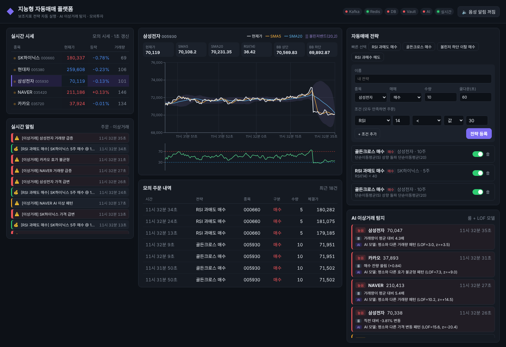
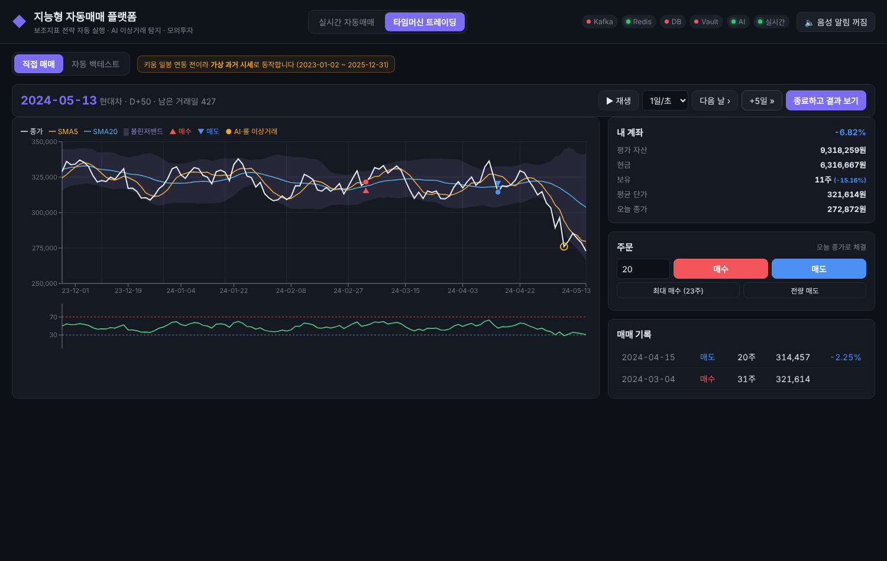
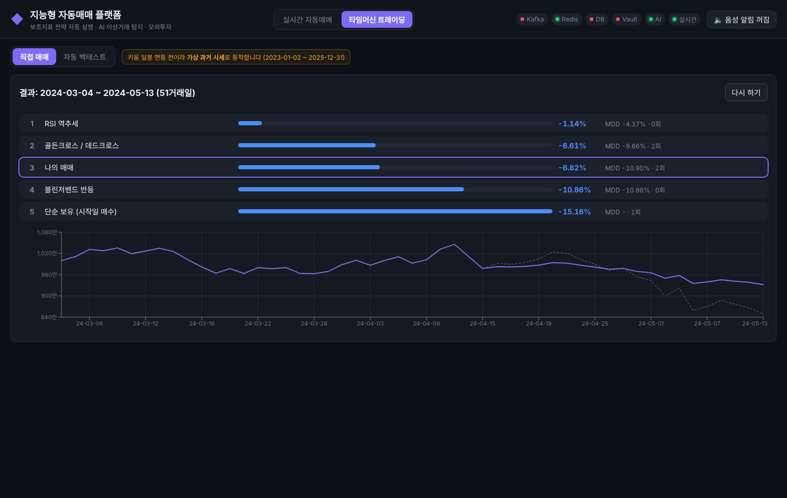
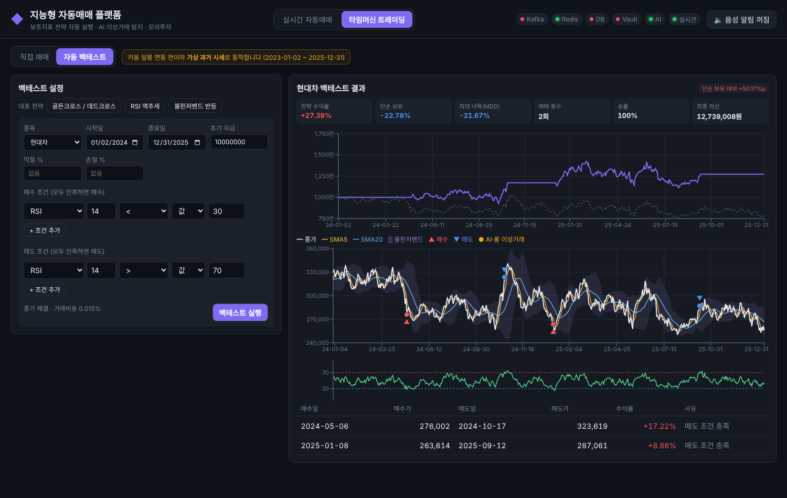

# 보조지표 기반 지능형 자동매매 플랫폼

사용자가 직접 설정한 투자 전략을 실시간 시세에 따라 자동으로 실행하고, 과거 시점으로 돌아가 검증하며, 이상 거래까지 감지하는 통합 투자 플랫폼입니다.
키움증권 REST API를 활용하며, **모든 거래는 모의투자 기반**으로 동작합니다.

## 핵심 기능

| 기능 | 설명 |
|---|---|
| 자동매매 엔진 | 볼린저밴드·RSI·이동평균 등 보조지표로 매수·매도 조건을 설정하면 실시간 시세에 맞춰 모의 주문을 자동 실행하고 실시간·음성 알림 제공 |
| 이상 거래 탐지 | 시세·거래량·호가 데이터를 분석해 거래량 급증, 가격 급변, 호가 불균형 등 이상 징후를 탐지하고 경보 제공 |
| 타임머신 트레이딩 | 과거 특정 시점의 시세를 재생하며 자동 백테스트 모드와 직접 매매 모드로 전략 검증 |
| 모의투자 가상계좌 | 가입하면 1,000만 원 가상계좌 개설. 직접 주문과 자동매매 주문이 같은 계좌에서 잔고 확인 후 체결되고, 수익률·실현손익·전략별 성과 제공 |

## 화면



실시간 시세·보조지표 차트, 전략 등록(조건 빌더·프리셋), 모의 주문 내역, AI 이상거래 경보, WebSocket 실시간 알림과 음성 알림(TTS)을 한 화면에서 제공합니다.

### 타임머신 트레이딩

| 직접 매매 | 결과 비교 | 자동 백테스트 |
|---|---|---|
|  |  |  |

- **직접 매매**: 과거 날짜로 돌아가 그날까지의 차트만 보고 매수·매도. 하루씩 또는 자동 재생으로 시간을 진행하며, 미래 시세는 서버가 보내지 않아 미리 볼 수 없음. 차트에 그 시점까지의 이상거래(ai 컨테이너 탐지)를 표시
- **결과 비교**: 종료하면 같은 기간의 단순 보유, 대표 전략 3개(골든크로스, RSI 역추세, 볼린저 반등)와 수익률·MDD 순위 비교
- **자동 백테스트**: 매수·매도 조건(+ 익절·손절)으로 과거 기간을 시뮬레이션, 수익률·MDD·승률·자산 곡선·매매 지점 표시
- `.env`에 `PUBLIC_DATA_SERVICE_KEY`를 넣으면 금융위원회 주식시세정보의 실제 일봉을 PostgreSQL에 저장해 사용합니다. 키가 없거나 API 장애가 나면 **교육용 가상 과거 시세**로 동작합니다.

## 시스템 구성

```
키움 REST API ──> [Backend: Kafka Producer] ──> Kafka (stock.price)
                                                  │
                    ┌─────────────────────────────┼──────────────────────┐
                    ▼                             ▼                      ▼
          [전략 매칭 엔진 + Redis]        [AI 이상탐지 서비스]      [타임머신 재생기]
                    │                             │                      │
                    └──────── 모의 주문 / 알림 ───┴──────── 결과 ────────┘
                                                  │
                                           [Frontend: React]
          민감정보(API 키) ── HashiCorp Vault
```

## 기술 스택

| 구분 | 사용 기술 |
|---|---|
| Backend | Python, FastAPI |
| Frontend | React (Vite) |
| AI | scikit-learn (LOF 이상탐지) |
| 메시징·캐시 | Apache Kafka, Redis |
| 보조지표 | TA-Lib |
| 보안 | HashiCorp Vault |
| 성능 테스트 | k6 |
| 데이터 | PostgreSQL (과거 시세 저장) |
| 인프라 | Docker, Docker Compose, nginx |
| CI | GitHub Actions (워크플로 7개) |

## 폴더 구조

```
auto-trading-platform/
├── backend/        # FastAPI 서버 (시세 수집, 전략 엔진, 주문, 백테스트)
├── frontend/       # React 웹 화면
├── ai/             # 이상거래 탐지 모델 및 추론
├── docs/           # 설계 문서, 평가항목 체크리스트
├── .github/        # PR·Issue 템플릿, Actions 워크플로
├── docker-compose.yml
└── .env.example
```

## 실행 방법

```bash
# 1. 환경 변수 파일 만들기 (실제 키는 절대 커밋하지 않기)
cp .env.example .env

# 공공데이터포털에서 발급한 금융위원회 주식시세정보 일반 인증키 입력
# PUBLIC_DATA_SERVICE_KEY=...

# 2. 전체 실행 (컨테이너 8개)
docker compose up -d --build

# 3. 컨테이너 간 통신·실시간 시세 확인
curl http://localhost:8000/health/deps
curl http://localhost:8000/market/prices

# 4. http://localhost:3000 에서 회원가입 후 사용

# 5. (선택) 프론트엔드 개발 서버
cd frontend
npm install
npm run dev     # http://localhost:5173
```

| 서비스 | 주소 |
|---|---|
| Backend API 문서 | http://localhost:8000/docs |
| Frontend (Docker) | http://localhost:3000 |
| Frontend (개발 서버) | http://localhost:5173 |
| AI 이상탐지 API | http://localhost:8001/docs |
| Vault UI | http://localhost:8200 |
| Kafka | localhost:9092 |
| Redis | localhost:6379 |

## 가상계좌 연습 (금융위원회 실제 종가)

모의투자 → 💰 가상계좌 연습에서 실제 거래일의 최신 종가로 가상 매매합니다.

- `.env`의 `PUBLIC_DATA_SERVICE_KEY`로 금융위원회 주식시세정보를 조회합니다 (키는 절대 커밋하지 않기)
- 주문과 보유자산 평가는 최근 실제 거래일의 종가를 사용하며, 가격 기준일과 `public_data` 출처를 함께 반환합니다
- 같은 종목의 최신 가격은 10분간 보관해 공공데이터 호출량을 줄입니다
- 키가 없거나 공공데이터 호출이 실패하면 기존 키움·가상 시세로 자동 대체합니다
- 종목 검색·시장·업종 분류는 기존 `/stocks/*` 기능을 그대로 사용합니다

## 모의투자 가상계좌와 자동매매

직접 주문과 자동매매(모의 주문) 전략이 **같은 가상계좌**를 씁니다.

- **계좌 개설**: 회원가입하면 1,000만 원 가상계좌가 바로 생깁니다 (예전 가입자는 처음 사용할 때 개설)
- **자동매매 연결**: 모의 주문 전략(`account: "paper"`)의 조건이 맞으면 `PaperBroker`(`backend/app/strategy/broker.py`)가 전략이 본 시세로 가상계좌에 체결합니다
  - 현금이나 보유 수량이 부족하면 계좌를 바꾸지 않고 **주문 거부**(`REJECTED`)로 기록하고, 사유를 알림으로 보냅니다 (예: "보유 수량이 부족해요. 지금 0주 가지고 있어요")
  - 주문 상태: `FILLED`(체결) / `SUBMITTED`(접수) / `REJECTED`(거부). 키움 실거래 전략(`account: "kiwoom"`)은 `app/trading`이 따로 처리합니다
- **익절·손절**: 모의 매수 전략에 `take_profit_pct`·`stop_loss_pct`(%)를 넣으면, 평균 단가 대비 그만큼 오르거나 내렸을 때 **그 전략이 산 수량만** 매도합니다 (백테스트와 같은 기준, 빈칸이면 사용 안 함)
- **수수료·손익**: 매수·매도 각 0.015%. 실현손익 = 매도 금액 − 매도 수수료 − (매입 금액 + 매수 수수료)
- **계좌 화면** (모의투자 → 💰 가상계좌 연습): 총 자산·수익률·현금·실현손익, 보유 종목, 거래 기록(직접 / 전략 이름 구분), 전략별 성과(거래 수·실현손익·승률)
- **초기화**: 현금·보유 종목·거래 기록과 자동매매 모의 주문 내역을 지웁니다. 등록한 전략과 키움 실주문 기록은 그대로입니다

## 인증과 민감정보 관리

- 회원가입·로그인 후 받은 JWT를 `Authorization: Bearer <토큰>` 헤더로 보낸다 (유효 12시간)
- 비밀번호는 PBKDF2-SHA256(사용자별 salt, 200,000회)으로 해시해서 저장
- **JWT 서명 키는 HashiCorp Vault(`secret/trading`)에 보관**한다. 처음 실행할 때 백엔드가 키를 만들어 Vault에 저장하고, 이후에는 Vault에서 읽는다. 코드나 `.env`에 키가 남지 않는다
- 로그인이 필요한 기능: 전략, 주문 내역, 타임머신 직접 매매 세션 (모두 본인 것만 보임)
- 공개 기능: 시세, 지표, 이상거래 경보, 백테스트
- 실시간 알림 WebSocket은 `?token=`을 붙이면 내 주문 알림까지, 없으면 이상거래 알림만 받는다

## 주요 API

| 메서드 | 경로 | 설명 |
|---|---|---|
| POST | `/auth/register`, `/auth/login` | 회원가입 / 로그인 (JWT 발급) |
| GET | `/auth/me` | 내 계정 |
| GET | `/market/quote/{종목코드}` | 현재가 + 실시간 구독 대상에 추가 (실거래 화면) |
| POST | `/market/watch/{종목코드}` | 보고 있는 종목 → 실시간 구독 대상 |
| GET | `/market/prices` | 실시간 구독 중인 종목 최신 시세 |
| GET | `/market/ticks/{종목코드}` | 종목별 최근 시세 |
| GET | `/market/chart/{종목코드}` | 차트용 시세 + 지표 시계열 |
| GET | `/indicators/{종목코드}` | SMA·RSI·볼린저밴드 최신값 |
| GET | `/stocks/status` | 가상계좌 연습 시세 출처(키움/가상)·장 운영 여부 |
| GET | `/stocks/search?q=`, `/stocks/browse`, `/stocks/sectors` | 종목 검색 / 시장·업종별 목록(시가총액·상승률·하락률·거래량순) / 업종 |
| GET | `/stocks/{종목코드}`, `/stocks/{종목코드}/daily` | 현재가 / 일봉 (키움 ka10095, ka10081) |
| GET | `/edu/account` | 가상계좌 요약 (현금·보유 종목·거래 기록·전략별 성과) |
| POST | `/edu/account/orders` | 가상계좌 직접 주문 (현재가 시장가) |
| POST | `/edu/account/reset` | 가상계좌 초기화 |
| GET / PUT / DELETE | `/edu/watchlist`, `/edu/watchlist/{종목코드}` | 가상계좌 연습 관심종목 |
| POST / GET | `/strategies` | 매매 전략 등록 / 목록 |
| GET / PUT / DELETE | `/strategies/{id}` | 전략 조회 / 수정 / 삭제 |
| GET | `/orders` | 모의 주문 내역 (체결·접수·거부) |
| GET | `/alerts` | 최근 알림 (주문 + 이상거래) |
| GET | `/anomalies` | AI 이상거래 경보 ([설명](docs/anomaly-detection.md)) |
| WS | `/ws/alerts` | 실시간 알림 (Redis Pub/Sub → WebSocket) |
| GET | `/history/symbols`, `/history/{종목코드}` | 과거 일봉 (타임머신용) |
| GET / POST | `/backtest/presets`, `/backtest` | 대표 전략 / 자동 백테스트 |
| POST | `/timemachine/sessions` | 직접 매매 세션 시작 (과거 날짜로 이동) |
| GET | `/timemachine/sessions/{id}` | 현재 날짜까지의 차트·계좌 |
| POST | `/timemachine/sessions/{id}/step`, `/order`, `/finish` | 시간 진행 / 주문 / 종료 후 결과 비교 |
| GET / PUT | `/trading/kiwoom/settings` | 실거래 설정 (모의·실전 서버, 1회 주문 한도, 일일 손실 한도) |
| POST | `/trading/kiwoom/activate`, `/deactivate` | 실거래 켜기(확인 문구) / 긴급 정지 |
| GET | `/trading/kiwoom/account` | 키움 계좌 잔고·보유 종목·오늘 손실 |
| POST / GET | `/trading/kiwoom/orders` | 키움 주문 / 내역 (체결 동기화) ([설명](docs/kiwoom.md)) |

전략 예시 (RSI가 30 아래이고 현재가가 볼린저밴드 하단을 뚫으면 10주 매수):

```json
{
  "name": "과매도 반등 매수",
  "symbol": "005930",
  "side": "buy",
  "quantity": 10,
  "cooldown_sec": 60,
  "conditions": [
    {"left": {"name": "RSI", "period": 14}, "op": "<", "right": 30},
    {"left": {"name": "PRICE"}, "op": "<", "right": {"name": "BB_LOWER", "period": 20, "k": 2}}
  ]
}
```

- 지표: `PRICE`, `SMA`, `EMA`, `RSI`, `BB_UPPER`, `BB_MIDDLE`, `BB_LOWER`
- 연산자: `<`, `<=`, `>`, `>=`, `cross_up`(상향 돌파), `cross_down`(하향 돌파)
- 조건은 모두 만족(AND)해야 주문이 실행됩니다.
- 모의 매수 전략에는 `"take_profit_pct": 5, "stop_loss_pct": 3`처럼 익절·손절(%)을 함께 넣을 수 있습니다.

## 팀원 및 역할

| 이름 | 역할 |
|---|---|
| 전창완 | 백엔드 |
| 임세은 | 백엔드 |
| 김호 | 프론트엔드 |
| 정재영 | 보안 |
| 이종한 | AI |

## 협업 규칙

브랜치 전략, 커밋 메시지, PR 규칙은 [CONTRIBUTING.md](CONTRIBUTING.md)를 참고하세요.
