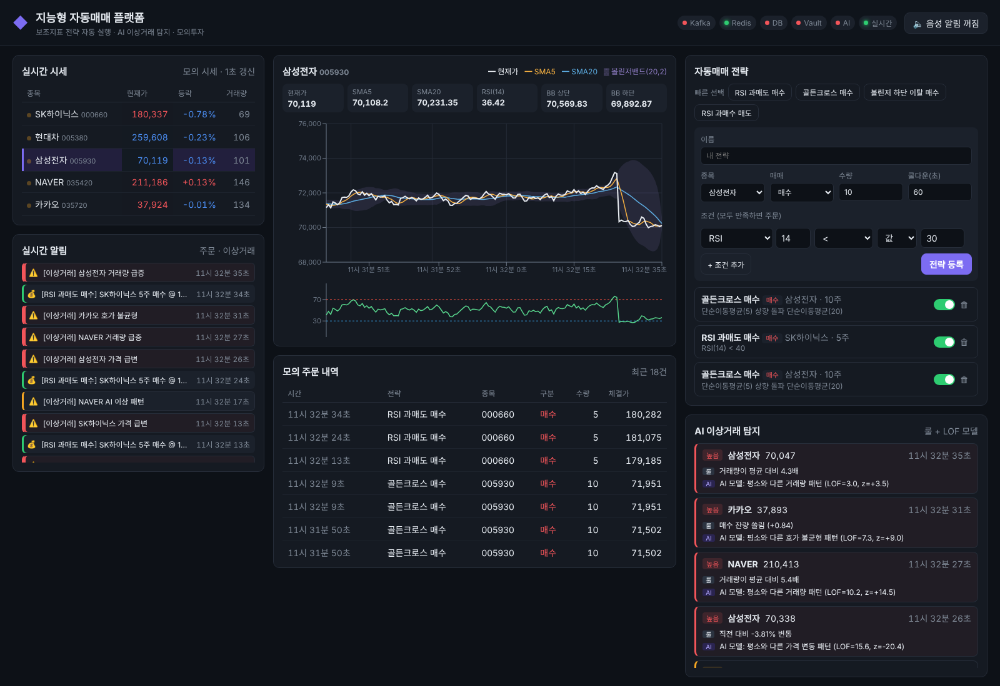
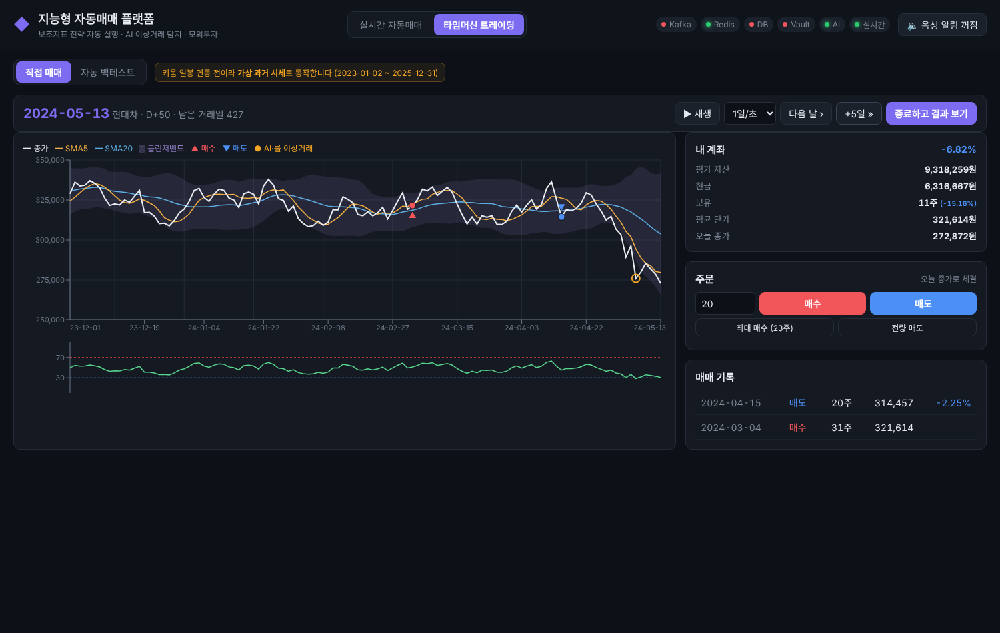
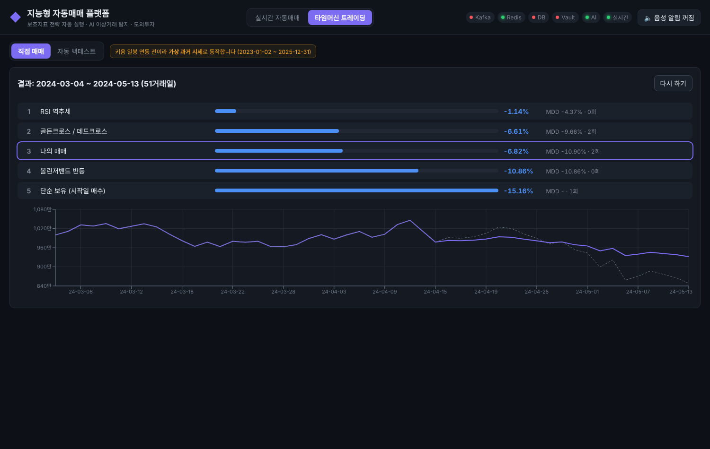
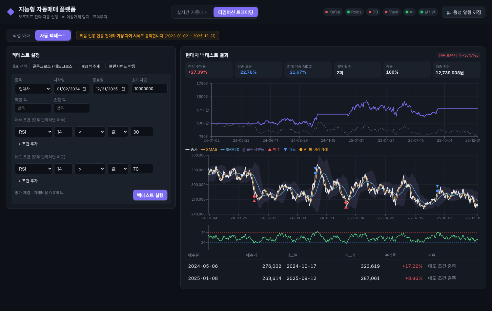

# 보조지표 기반 지능형 자동매매 플랫폼

사용자가 직접 설정한 투자 전략을 실시간 시세에 따라 자동으로 실행하고, 과거 시점으로 돌아가 검증하며, 이상 거래까지 감지하는 통합 투자 플랫폼입니다.
키움증권 REST API를 활용하며, **모든 거래는 모의투자 기반**으로 동작합니다.

## 핵심 기능

| 기능 | 설명 |
|---|---|
| 자동매매 엔진 | 볼린저밴드·RSI·이동평균 등 보조지표로 매수·매도 조건을 설정하면 실시간 시세에 맞춰 모의 주문을 자동 실행하고 실시간·음성 알림 제공 |
| 이상 거래 탐지 | 시세·거래량·호가 데이터를 분석해 거래량 급증, 가격 급변, 호가 불균형 등 이상 징후를 탐지하고 경보 제공 |
| 타임머신 트레이딩 | 과거 특정 시점의 시세를 재생하며 자동 백테스트 모드와 직접 매매 모드로 전략 검증 |

## 화면



실시간 시세·보조지표 차트, 전략 등록(조건 빌더·프리셋), 모의 주문 내역, AI 이상거래 경보, WebSocket 실시간 알림과 음성 알림(TTS)을 한 화면에서 제공합니다.

### 타임머신 트레이딩

| 직접 매매 | 결과 비교 | 자동 백테스트 |
|---|---|---|
|  |  |  |

- **직접 매매**: 과거 날짜로 돌아가 그날까지의 차트만 보고 매수·매도. 하루씩 또는 자동 재생으로 시간을 진행하며, 미래 시세는 서버가 보내지 않아 미리 볼 수 없음. 차트에 그 시점까지의 이상거래(ai 컨테이너 탐지)를 표시
- **결과 비교**: 종료하면 같은 기간의 단순 보유, 대표 전략 3개(골든크로스, RSI 역추세, 볼린저 반등)와 수익률·MDD 순위 비교
- **자동 백테스트**: 매수·매도 조건(+ 익절·손절)으로 과거 기간을 시뮬레이션, 수익률·MDD·승률·자산 곡선·매매 지점 표시
- 키움 일봉 연동 전까지는 **가상 과거 시세**(2023-01-02 ~ 2025-12-31, 상승·하락·횡보 구간 포함)로 동작

## 시스템 구성

```
키움 REST API ──> [Backend: Kafka Producer] ──> Kafka (stock.price)
                                                  │
                    ┌─────────────────────────────┼──────────────────────┐
                    ▼                             ▼                      ▼
          [전략 매칭 엔진 + Redis]        [AI 이상탐지 서비스]      [타임머신 재생기]
                    │                             │                      │
                    └──────── 모의 주문 / 알림 ───┴──────── 결과 ────────┘
                                                  │
                                           [Frontend: React]
          민감정보(API 키) ── HashiCorp Vault
```

## 기술 스택

| 구분 | 사용 기술 |
|---|---|
| Backend | Python, FastAPI |
| Frontend | React (Vite) |
| AI | scikit-learn (LOF 이상탐지) |
| 메시징·캐시 | Apache Kafka, Redis |
| 보조지표 | TA-Lib |
| 보안 | HashiCorp Vault |
| 성능 테스트 | k6 |
| 데이터 | PostgreSQL (과거 시세 저장) |
| 인프라 | Docker, Docker Compose, nginx |
| CI | GitHub Actions (워크플로 7개) |

## 폴더 구조

```
auto-trading-platform/
├── backend/        # FastAPI 서버 (시세 수집, 전략 엔진, 주문, 백테스트)
├── frontend/       # React 웹 화면
├── ai/             # 이상거래 탐지 모델 및 추론
├── docs/           # 설계 문서, 평가항목 체크리스트
├── .github/        # PR·Issue 템플릿, Actions 워크플로
├── docker-compose.yml
└── .env.example
```

## 실행 방법

```bash
# 1. 환경 변수 파일 만들기 (실제 키는 절대 커밋하지 않기)
cp .env.example .env

# 2. 전체 실행 (컨테이너 8개)
docker compose up -d --build

# 3. 컨테이너 간 통신·실시간 시세 확인
curl http://localhost:8000/health/deps
curl http://localhost:8000/market/prices

# 4. (선택) 프론트엔드 개발 서버
cd frontend
npm install
npm run dev     # http://localhost:5173
```

| 서비스 | 주소 |
|---|---|
| Backend API 문서 | http://localhost:8000/docs |
| Frontend (Docker) | http://localhost:3000 |
| Frontend (개발 서버) | http://localhost:5173 |
| AI 이상탐지 API | http://localhost:8001/docs |
| Vault UI | http://localhost:8200 |
| Kafka | localhost:9092 |
| Redis | localhost:6379 |

## 주요 API

| 메서드 | 경로 | 설명 |
|---|---|---|
| GET | `/market/prices` | 전 종목 최신 시세 |
| GET | `/market/ticks/{종목코드}` | 종목별 최근 시세 |
| GET | `/market/chart/{종목코드}` | 차트용 시세 + 지표 시계열 |
| GET | `/indicators/{종목코드}` | SMA·RSI·볼린저밴드 최신값 |
| POST / GET | `/strategies` | 매매 전략 등록 / 목록 |
| GET / PUT / DELETE | `/strategies/{id}` | 전략 조회 / 수정 / 삭제 |
| GET | `/orders` | 모의 주문 내역 |
| GET | `/alerts` | 최근 알림 (주문 + 이상거래) |
| GET | `/anomalies` | AI 이상거래 경보 ([설명](docs/anomaly-detection.md)) |
| WS | `/ws/alerts` | 실시간 알림 (Redis Pub/Sub → WebSocket) |
| GET | `/history/symbols`, `/history/{종목코드}` | 과거 일봉 (타임머신용) |
| GET / POST | `/backtest/presets`, `/backtest` | 대표 전략 / 자동 백테스트 |
| POST | `/timemachine/sessions` | 직접 매매 세션 시작 (과거 날짜로 이동) |
| GET | `/timemachine/sessions/{id}` | 현재 날짜까지의 차트·계좌 |
| POST | `/timemachine/sessions/{id}/step`, `/order`, `/finish` | 시간 진행 / 주문 / 종료 후 결과 비교 |

전략 예시 (RSI가 30 아래이고 현재가가 볼린저밴드 하단을 뚫으면 10주 매수):

```json
{
  "name": "과매도 반등 매수",
  "symbol": "005930",
  "side": "buy",
  "quantity": 10,
  "cooldown_sec": 60,
  "conditions": [
    {"left": {"name": "RSI", "period": 14}, "op": "<", "right": 30},
    {"left": {"name": "PRICE"}, "op": "<", "right": {"name": "BB_LOWER", "period": 20, "k": 2}}
  ]
}
```

- 지표: `PRICE`, `SMA`, `EMA`, `RSI`, `BB_UPPER`, `BB_MIDDLE`, `BB_LOWER`
- 연산자: `<`, `<=`, `>`, `>=`, `cross_up`(상향 돌파), `cross_down`(하향 돌파)
- 조건은 모두 만족(AND)해야 주문이 실행됩니다.

## 팀원 및 역할

| 이름 | 역할 |
|---|---|
| 전창완 | 백엔드 |
| 임세은 | 백엔드 |
| 김호 | 프론트엔드 |
| 정재영 | 보안 |
| 이종한 | AI |

## 협업 규칙

브랜치 전략, 커밋 메시지, PR 규칙은 [CONTRIBUTING.md](CONTRIBUTING.md)를 참고하세요.
